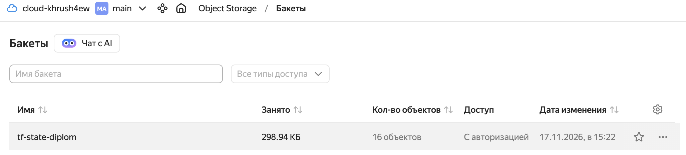
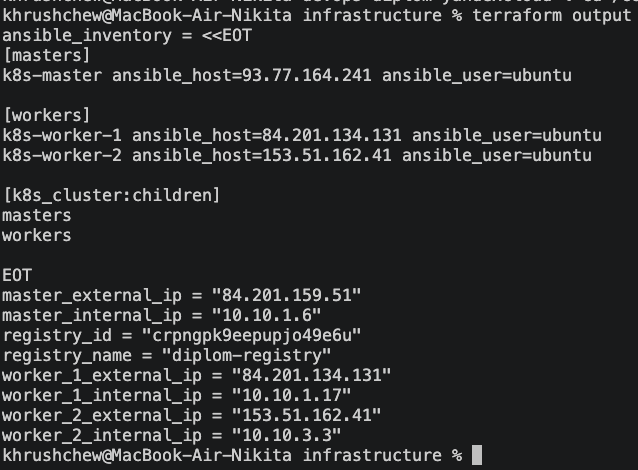
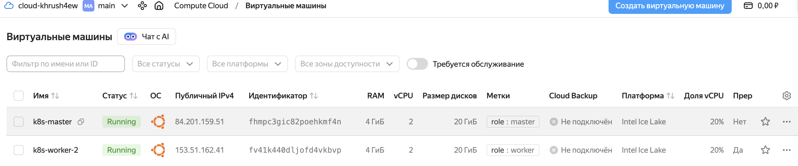
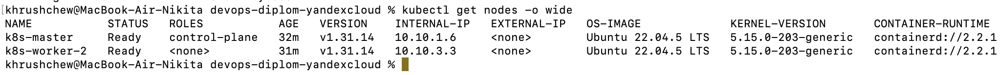
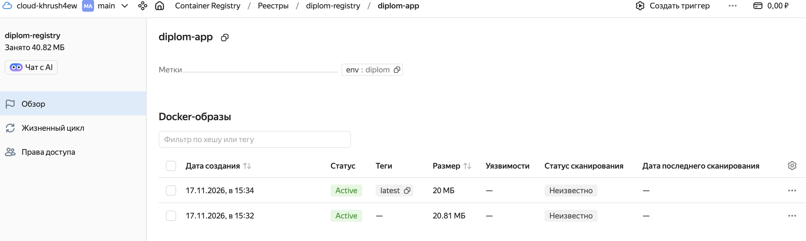
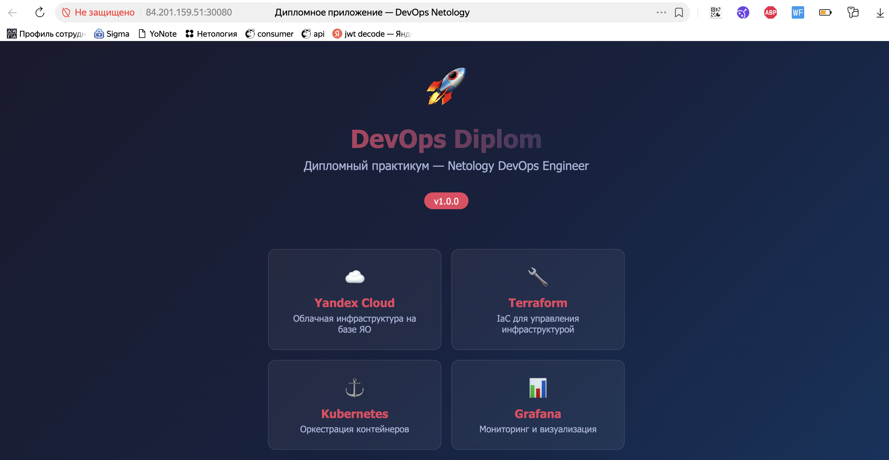
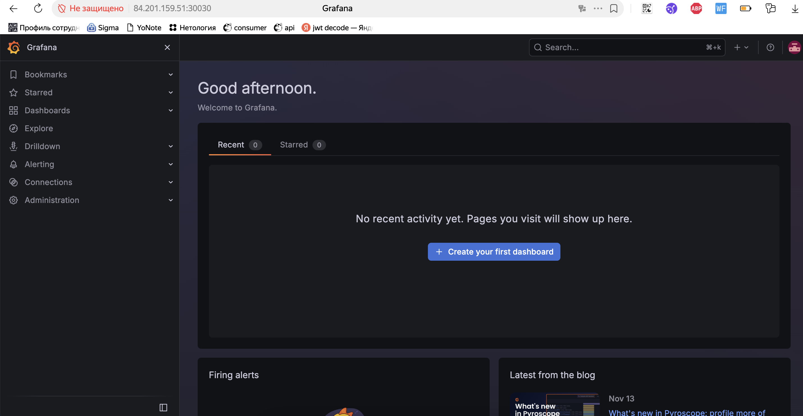
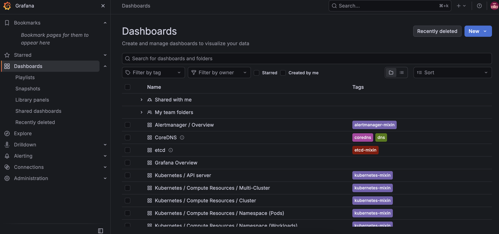

# Дипломный практикум — Netology DevOps Engineer

## Цели

1. Подготовить облачную инфраструктуру на базе Yandex.Cloud (Terraform)
2. Запустить и сконфигурировать Kubernetes кластер
3. Установить и настроить систему мониторинга (Prometheus + Grafana)
4. Настроить и автоматизировать сборку тестового приложения (Docker)
5. Настроить CI/CD (GitHub Actions)

---

## Этап 1 — Облачная инфраструктура

### Структура Terraform

```
terraform/
├── bootstrap/        # Одноразовый запуск: SA + S3 bucket
└── infrastructure/   # Основная инфраструктура (VPC, ВМ, Registry)
```

**Bootstrap** создаёт:
- Сервисный аккаунт `terraform-sa` с ролями `editor` и `storage.admin`
- S3 bucket `tf-state-diplom` для хранения Terraform state
- Статический ключ доступа к бакету

**Infrastructure** создаёт:
- VPC `k8s-network` с подсетями в зонах `ru-central1-a` и `ru-central1-d`
- Security Group: SSH (22), K8s API (6443), NodePort (30000-32767)
- ВМ: `k8s-master` (зона a) + 2 worker (прерываемые)
- Yandex Container Registry `diplom-registry`

### Запуск

```bash
# 1. Bootstrap (один раз)
cd terraform/bootstrap && terraform init && terraform apply

# 2. Создать ключ сервисного аккаунта
yc iam key create --service-account-id <SA_ID> --output sa-key.json

# 3. Основная инфраструктура
cd terraform/infrastructure
terraform init -backend-config=backend.conf
terraform apply
```

### Результат

| Ресурс | Значение |
|--------|----------|
| S3 Backend | `tf-state-diplom` |
| Master IP | `84.201.159.51` |
| Worker-2 IP | `153.51.162.41` |
| Registry | `cr.yandex/crpngpk9eepupjo49e6u` |

**Скриншот 1 — S3 bucket:** 

**Скриншот 2 — terraform output:** 

**Скриншот 3 — ВМ в Yandex Cloud:** 

---

## Этап 2 — Kubernetes кластер

Кластер поднят с помощью `kubeadm` на Ubuntu 22.04.

| Узел | Роль | Зона | IP |
|------|------|------|-|
| k8s-master | control-plane | ru-central1-a | 84.201.159.51 |
| k8s-worker-2 | worker | ru-central1-d | 153.51.162.41 |

- **Kubernetes**: v1.31.14  
- **CRI**: containerd v2.2.1  
- **CNI**: Flannel

```bash
# Инициализация мастера
kubeadm init \
  --apiserver-advertise-address=10.10.1.6 \
  --apiserver-cert-extra-sans=84.201.159.51 \
  --pod-network-cidr=10.244.0.0/16

kubectl apply -f https://github.com/flannel-io/flannel/releases/latest/download/kube-flannel.yml
```

**Скриншот 4 — kubectl get nodes:** 

---

## Этап 3 — Тестовое приложение

nginx со статической страницей. Собирается в Docker для `linux/amd64`.

```bash
docker buildx build --platform linux/amd64 \
  -t cr.yandex/crpngpk9eepupjo49e6u/diplom-app:latest \
  --push ./app/
```

**Образ:** `cr.yandex/crpngpk9eepupjo49e6u/diplom-app:latest`

**Скриншот 7 — Container Registry:** 

---

## Этап 4 — Мониторинг и деплой приложения

```bash
helm upgrade --install monitoring prometheus-community/kube-prometheus-stack \
  -n monitoring --create-namespace -f k8s/monitoring/values.yaml
```

| Сервис | URL |
|--------|-----|
| Тестовое приложение | http://84.201.159.51:30080 |
| Grafana | http://84.201.159.51:30030 (admin/admin) |

**Скриншот 5 — Тестовое приложение:** 

**Скриншот 6 — Grafana:** 

**Скриншот 8 — Дашборды K8s в Grafana:** 

---

## Этап 5 — CI/CD (GitHub Actions)

| Workflow | Триггер | Действие |
|----------|---------|----------|
| `ci-cd.yml` | push main | Сборка Docker → push в YCR |
| `ci-cd.yml` | тег `v*.*.*` | Сборка + push + **деплой в K8s** |
| `terraform.yml` | push main (terraform/**) | `terraform apply` |
| `terraform.yml` | pull_request | `terraform plan` → комментарий |

### Секреты GitHub Actions

| Секрет | Описание |
|--------|----------|
| `YC_SA_JSON_KEY` | JSON ключ сервисного аккаунта |
| `YC_REGISTRY_ID` | ID Container Registry |
| `YC_FOLDER_ID` | ID каталога ЯО |
| `YC_CLOUD_ID` | ID облака ЯО |
| `TF_S3_ACCESS_KEY` | Access key для S3 backend |
| `TF_S3_SECRET_KEY` | Secret key для S3 backend |
| `K8S_KUBECONFIG` | kubeconfig в base64 |

```bash
# Добавить все секреты одной командой
bash scripts/setup-github-secrets.sh <GITHUB_PAT>

# Запустить деплой через тег
git tag v1.0.0 && git push origin v1.0.0
```
